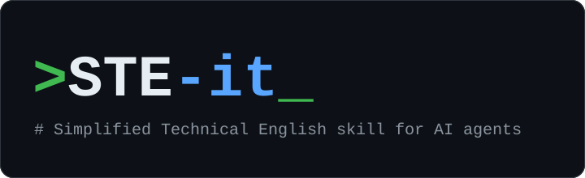

<p align="center"></p>

# STE-it: Simplified Technical English skill for AI agents

STE-it (`ste-it`) is an agent skill. The skill makes an AI agent write technical text in Simplified Technical English (STE). STE is a controlled form of English. The goal of STE is that each reader gets the same meaning on the first read.

The readers of technical text include people whose first language is not English, people in a hurry, machine translators, search tools and AI agents. STE helps all of these readers with limits on sentence length, sentence structure and vocabulary.

The skill follows the writing rules of the [ASD-STE100 specification](https://www.asd-ste100.org/). The skill does not make text compliant with ASD-STE100, and it does not give STE certification.

## Why use STE for documentation

AI agents now write a large part of our documentation. Agents also read it, for example when they load a README or a spec into their context. The result is often long text with a style that changes from one document to the next.

A human reader who is not sure about a sentence can ask the writer. An AI agent does not ask. The agent chooses one meaning and acts on that meaning.

STE removes the most frequent causes of an incorrect reading:

- Long sentences with more than one topic
- Words with more than one meaning, such as "should"
- Two different names for one thing, such as "config file" and "settings file"
- Idioms, phrasal verbs and vague quantities, such as "soon" or "a few"

## What the skill does

The skill has two modes:

- **Style layer.** You ask for a document, such as a spec, a plan, a task list or a runbook. You also tell the agent to use STE. The request or another skill sets the content and the structure. This skill sets the form of each sentence.
- **Converter.** You give the agent text and ask for it in STE. The agent rewrites the text. The rewrite keeps the meaning, the structure and all technical content.

The skill has two levels. The cost of an incorrect reading sets the level.

| Level | Use the level for |
| --- | --- |
| Strict | Text that an AI agent reads (system prompts, tool descriptions, `AGENTS.md`, skill files), procedures, runbooks, warnings, requirements, task lists and public API docs |
| Light | Design rationale, PR descriptions, commit messages, release notes, code comments and emails |

A document can contain the two types of text. In a runbook, the skill uses the strict level for the steps and the light level for the background.

The skill keeps these items exactly as they are:

- Code, commands, file paths, URLs and configuration keys
- Identifiers, such as the names of classes, methods and endpoints
- Text quoted from another source
- Product names
- Requirement keywords that a spec defines, such as MUST and SHOULD (RFC 2119)

## Example

This example shows a tool description for an AI agent, at the strict level.

<!-- ste-ignore-start -->
Before:

> Use this to look up orders. You should pass the customer ID if you have it, otherwise it'll fall back to searching by email, which may be slow. Results might be paginated.
<!-- ste-ignore-end -->

After:

> The `find_orders` tool finds the orders of one customer.
>
> - If you know the customer ID, give `customer_id`.
> - If you do not know the customer ID, give `email`. The search by `email` takes up to 10 seconds.
> - The tool returns a maximum of 50 orders. If the reply contains `next_page`, call the tool again with that value.

## Install the skill

The skill works with agents that support the Agent Skills format, such as Claude Code and GitHub Copilot in VS Code.

### Install for Claude Code

1. Clone the repository into your personal skills folder:

   ```bash
   git clone https://github.com/iamchrisfildes/ste-it-skill.git ~/.claude/skills/ste-it
   ```

2. Start a new Claude Code session.

To install the skill for one project only, clone the repository into the `.claude/skills/ste-it` folder of that project.

### Install for GitHub Copilot in VS Code

1. Clone the repository into your personal Copilot skills folder:

   ```bash
   git clone https://github.com/iamchrisfildes/ste-it-skill.git ~/.copilot/skills/ste-it
   ```

2. Start a new chat session in VS Code.

To install the skill for one project only, clone the repository into the `.github/skills/ste-it` folder of that project.

VS Code also reads skills from `~/.claude/skills/`. If you installed the skill for Claude Code, VS Code can use that copy.

The name of the skill folder must be `ste-it`. This name must be the same as the `name` field in `SKILL.md`. If the two names are different, VS Code does not load the skill. The name of the repository is `ste-it-skill`, so always give the folder name `ste-it` when you clone or copy the repository.

### Install for other agents

1. Download the repository.
2. Copy the repository folder into the skills folder of your agent.
3. Change the name of the folder to `ste-it`.
4. Start a new agent session.

### Requirements for the checker script

The checker script needs Python 3.10 or later. The script uses only the Python standard library.

## Use the skill

Tell the agent to use STE in your request. For example:

- "Write a runbook for the database failover. Use STE."
- "Write the spec for the orders API in STE."
- "Convert this README to Simplified Technical English."
- "Rewrite this system prompt in strict STE."

The skill applies only when you ask for STE. The skill does not change the text of other requests.

## Checker script

The skill includes the script `scripts/check_ste.py`. The agent runs the script before it gives you the document. You can also run the script yourself:

```bash
python scripts/check_ste.py FILE --level strict
```

- For text at the light level, use `--level light`.
- To read the text from standard input, use `-` in place of `FILE`.

The script finds these problems:

- Sentences longer than 20 words in a step, or 25 words in other text
- Paragraphs with more than 6 sentences
- Paragraphs and list items that start with a pronoun
- Steps that possibly contain two instructions
- Contractions, modal verbs, perfect tenses and possible passive verbs
- More than 3 nouns in a row
- Words from the word list in `references/word-list.md`

The script ignores code blocks, inline code, tables, headings and text in double quotes. The script also ignores the lines between `<!-- ste-ignore-start -->` and `<!-- ste-ignore-end -->`.

Each finding is a candidate, not an error. Correct the text, or keep the text for a reason, such as a technical name. The script returns exit code 0 if it finds no problems and exit code 1 if it finds problems.

The script cannot check meaning. For example, it cannot find two different words for one thing. The agent reads the text again for these problems.

## Tests

The `evals` folder contains 6 test cases:

| Test case | What the case tests |
| --- | --- |
| `spec-keeps-rfc-keywords` | A spec keeps the RFC 2119 keywords that it defines. |
| `converts-messy-runbook` | A conversion keeps the meaning, the commands and the names of a runbook. |
| `pr-description-short-message` | A PR description at the light level. |
| `task-list-keeps-template` | A task list keeps the template of another skill. |
| `agent-instructions-strict` | Instructions for an AI agent at the strict level. |
| `design-rationale-light` | A design rationale at the light level. |

Each case has a prompt, input files and graders.

## Files in the skill

```text
SKILL.md                 Instructions for the agent
references/word-list.md  Words to replace, and the replacements
scripts/check_ste.py     Checker script
evals/                   Test cases
assets/logo.svg          Logo
```

## Limits of the skill

- The skill does not make text compliant with ASD-STE100.
- The skill is for technical text. Do not use the skill for articles or other text that needs a personal voice.
- The checker script finds mechanical problems only. A person or an agent must read the text to find problems of meaning.

## License

The skill uses the MIT license. Refer to the `LICENSE` file.
